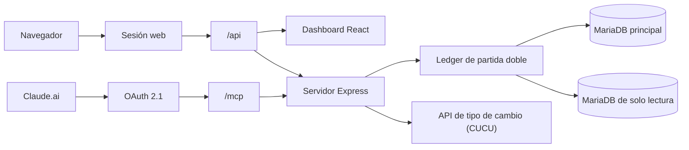

# FinanceManager

FinanceManager es una aplicación multiusuario con un servidor MCP remoto (Model Context Protocol) que permite a Claude.ai registrar y consultar finanzas personales conversando. Cada usuario tiene su propio libro contable auditable de partida doble y multimoneda (BOB/USD). Está construido con Node.js 22, TypeScript, Express y MariaDB 10.6, con OAuth 2.1 y un dashboard web en React. Se aloja en cPanel con Passenger. El servidor no llama a ninguna API de IA, así que la aplicación no añade coste de IA.

## Funcionalidades

- Registra gastos, ingresos, transferencias, cargas por lotes, conciliaciones y valuación patrimonial.
- Organiza las finanzas con cuentas, categorías, etiquetas y campos personalizados.
- Gestiona préstamos con interés simple y pagos aplicados primero a intereses.
- Gestiona desde Claude metas de ahorro por saldo de cuentas y topes de gasto por categoría, con período mensual o fechas elegidas.
- Registra la cotización oficial USD/BOB consultada a través de CUCU, un tercero sin afiliación al BCB, o permite anotarla manualmente.
- Permite consultar y deshacer operaciones, además de consultar datos mediante SQL de solo lectura.
- Ofrece un dashboard de resumen, movimientos, informes y actividad de Claude.
- Permite exportar los datos propios en JSON y borrar la cuenta desde el dashboard. La página pública **Privacidad y términos** explica qué datos se guardan.
- Muestra métricas agregadas de uso a la cuenta designada por el operador en la configuración.
- Protege el acceso y permite crear copias cifradas con guías de despliegue y recuperación.

## Stack

| Capa          | Tecnología                                                           |
| ------------- | -------------------------------------------------------------------- |
| Servidor      | Node.js 22, TypeScript y Express                                     |
| Datos         | MariaDB 10.6; libro de partida doble y base separada de solo lectura |
| Web           | React y Vite                                                         |
| Autenticación | Google OpenID Connect y OAuth 2.1 para Claude                        |
| Despliegue    | cPanel y Passenger                                                   |
| Pruebas       | Vitest y suites Bash                                                 |

## Demostración

Conversación ficticia; los importes y personas son de ejemplo:

> **Tú:** Registra 45,50 BOB de almuerzo desde Efectivo, en Gastos › Comida.
>
> **Claude:** Registré el gasto. Efectivo queda en 454,50 BOB. Operación: `op-ejemplo-01`.
>
> **Tú:** Transfiere 696 BOB a mi cuenta en USD. Recibí 100 USD.
>
> **Claude:** Registré ambos importes y la conversión. Operación: `op-ejemplo-02`.
>
> **Tú:** Presté 1.000 BOB a Ana el 1 de enero de 2024 al 2 % mensual. ¿Cuánto debe al 31 de enero?
>
> **Claude:** El interés simple acumulado es 19,73 BOB; el saldo total es 1.019,73 BOB.
>
> **Tú:** Deshaz el gasto del almuerzo.
>
> **Claude:** Gasto revertido. La transferencia y el préstamo siguen registrados.

## Arquitectura



## Uso

### Préstamos en Claude

- Usa `registrar_prestamo` para dar de alta el préstamo. Si es sin interés, indica tasa 0 y el período. Si el dinero ya se movió y quedó registrado en el historial, indica `sin_movimiento_de_caja`.
- Usa `consultar_prestamos` para ver el saldo a una fecha, el desglose y los abonos, o para listar por persona o estado con totales separados por moneda.
- Usa `abonar_prestamo` para registrar un pago. Cubre primero los intereses pendientes y luego el capital. Para corregirlo, ejecuta `deshacer_operacion` con el ID devuelto. Si hay abonos posteriores de ese préstamo, deshaz primero los más recientes.

### Dashboard v1

Abre la raíz del sitio y pulsa **Iniciar sesión con Google**. Usa la misma cuenta de Google para conectar Claude y ver tus datos en ambos sitios.

- **Resumen** muestra patrimonio, efectivo y cuentas de subtipo banco, ingresos y gastos frente al mes anterior, principales categorías y los últimos movimientos del mes elegido. El disponible se conserva por moneda. Las categorías se ordenan por su valor conocido en Bs al cierre. Si falta una cotización para un saldo, el patrimonio se muestra como parcial.
- **Cuentas** muestra saldos de activos y pasivos por moneda, permite incluir archivadas y abrir sus movimientos.
- **Movimientos** permite buscar y filtrar el libro. Los totales diarios incluyen todos los movimientos que coinciden con los filtros. **Informes** compara ingresos y gastos por moneda y muestra el patrimonio en Bs al cierre de cada mes. El rango admite hasta 60 meses.
- **Actividad de Claude** muestra los cambios de Claude y de la web. Deshacer agrega una operación de reversión con actor `web`. Si una operación posterior entra en conflicto, el ledger informa el motivo al intentar la reversión.
- **Cuenta** descarga tus datos en JSON con montos decimales exactos. Para borrar tus datos y revocar el acceso de Claude, escribe `BORRAR`. Si han pasado más de diez minutos desde que iniciaste sesión, vuelve a entrar con la misma cuenta de Google y confirma de nuevo.

La cookie de sesión dura 12 horas desde el inicio. Es `HttpOnly`, `SameSite=Strict` y usa `Secure` con el prefijo `__Host-` bajo HTTPS. La base solo guarda el hash del token. El inicio de sesión se limita por IP y se registra en la bitácora de autenticación. La API exige la sesión, usa `Cache-Control: no-store` y comprueba el origen configurado para toda solicitud distinta de GET o HEAD. Cerrar sesión revoca la sesión actual. El administrador puede revocar todas las sesiones y conexiones de un usuario con `npm run auth:tokens -- revoke-all <usuario>`.

Para probar con Vite, configura `PUBLIC_URL=http://localhost:5173` en tu entorno local y abre esa misma dirección. Vite reenvía la API, el login, la página de privacidad y el panel de métricas a Express. Con Express sirviendo el build, usa el origen de Express.

## Decisiones técnicas

- Partida doble con importes enteros en unidades menores, como centavos: [ADR 0003](docs/adr/0003-partida-doble-y-dinero.md).
- Bitácora append-only, borrado lógico y operaciones reversibles: [ADR 0006](docs/adr/0006-auditoria-y-deshacer.md).
- Consultas sobre una base separada `_ro` con vistas SQL SECURITY DEFINER y usuario lector: [ADR 0002](docs/adr/0002-mariadb.md).
- Inicio de sesión con Google y conexión OAuth de Claude mediante MCP. [Guía de despliegue](docs/operacion/despliegue.md)
- Monolito modular TypeScript: [ADR 0001](docs/adr/0001-monolito-modular-typescript.md).
- Extensiones controladas por metadatos: [ADR 0005](docs/adr/0005-extensibilidad-controlada.md).
- Despliegue en cPanel con Passenger sin costes recurrentes adicionales: [ADR 0007](docs/adr/0007-despliegue-cpanel-passenger.md).

## Calidad

La última ejecución documentada en M-017 reportó **51 pruebas unitarias/HTTP, 140 de integración y tres suites Bash**; también pasaron build, lint, typecheck y formato. La integración usó MariaDB 10.6.28. Comandos: `npm test`, `npm run test:integration`, `bash src/deploy/deploy.test.sh`, `bash src/deploy/backup.test.sh` y `bash src/deploy/guide.test.sh`.

## Puesta en marcha local

Requiere Node.js 22 y MariaDB 10.6. Sigue la [guía de entorno local](docs/desarrollo/entorno-local.md) para preparar la instancia de MariaDB, configurar `.env` y proporcionar la URL de administración al ejecutar `db:setup`.

```powershell
npm ci
npm run db:start
npm run db:setup
npm run dev
```

## Comandos

- `npm run dev` inicia Express y Vite. El endpoint de salud está en `http://localhost:3000/health` y la web se abre en `http://localhost:5173`. Puedes cambiar el puerto de Express con `PORT` en `.env`.
- `npm run build` genera `dist/` en cada workspace. Ejecuta `node app.js` para servir el build de la web, `/health` y `/mcp` desde el mismo proceso.
- `npm run migrate`, después de compilar, aplica migraciones sobre `MIGRATION_DATABASE_URL` y actualiza las vistas de `READONLY_DATABASE_NAME`. Con el `.env` de ejemplo apunta a `finance_dev` y `finance_dev_ro`.
- `/mcp` exige un token OAuth con ámbito `finance`. Configura `PUBLIC_URL`, `GOOGLE_CLIENT_ID`, `GOOGLE_CLIENT_SECRET` y `FIRST_USER_EMAIL`. Aplica la migración y vuelve a conectar Claude. El primer inicio de sesión con el correo configurado vincula los datos existentes. [Configuración de Google Cloud](docs/operacion/despliegue.md#cliente-oauth-en-google-cloud)
- Desde Claude puedes registrar gastos, importar capturas en lotes reversibles y consultar saldos, movimientos o patrimonio. Con `consulta_sql` puedes consultar tus datos y los tipos de cambio oficiales.
- El registro admite hasta 50 usuarios por defecto. Usa `MAX_USERS=0` para cerrar nuevas altas. `MAX_REQUESTS_PER_USER_PER_MINUTE` limita a 120 las peticiones autenticadas por usuario y minuto entre `/mcp` y `/api`.
- `npm run auth:tokens -- list <usuario>` lista los identificadores activos de ese usuario. `npm run auth:tokens -- revoke <usuario> <token>` revoca una familia.

## Pruebas

- `npm test` ejecuta las pruebas unitarias y HTTP sin MariaDB.
- `npm run test:integration` requiere el build y MariaDB local preparada con `db:setup`. **Borra y recrea** `finance_test` y `finance_test_ro` en cada ejecución. Comprueba el arranque, el esquema, los perfiles de acceso, la contabilidad, OAuth, MCP, las copias y la restauración. En Windows, usa Git para Windows y los clientes de `MARIADB_HOME/bin`. En Linux, Bash, `mysqldump` y `mysql` deben estar en `PATH`.
- `bash src/deploy/deploy.test.sh` comprueba el despliegue con dobles y un repositorio Git temporal. `bash src/deploy/backup.test.sh` y `bash src/deploy/guide.test.sh` comprueban las copias y la guía de operación. En Windows, usa WSL para las suites Bash y `FINANCE_TEST_WSL_BACKUP=1` en la integración para incluir la restauración real con GPG y flock.
- `npm run lint`, `npm run typecheck` y `npm run format:check` verifican el código y el formato.

## Estructura del repositorio

- `src/core/` contiene las validaciones y reglas contables puras, además del código compartido.
- `src/server/` contiene la app HTTP, su punto de entrada y los scripts de MariaDB local.
- `src/server/ledger/` contiene los servicios contables que escriben en MariaDB y registran la bitácora.
- `src/server/mcp/` valida entradas y adapta los servicios contables a las herramientas en español.
- `src/deploy/` contiene los scripts de despliegue y copias cifradas y sus pruebas en Bash.
- `src/web/` contiene la aplicación React y la configuración de shadcn/ui.
- `src/scripts/` contiene la comprobación de versión de Node para las pruebas.
- `docs/` contiene la documentación del proyecto.

## Despliegue

La [guía de despliegue](docs/operacion/despliegue.md) cubre cPanel, Passenger, rollback, alta de usuario y conexión de Claude con OAuth. La [guía de recuperación](docs/operacion/recuperacion.md) detalla la restauración de copias desde Drive.

## Hoja de ruta

Después del dashboard están previstos presupuestos y movimientos recurrentes.

## Licencia

Pendiente.

## English summary

FinanceManager is a remote MCP (Model Context Protocol) server that lets Claude.ai record and query personal finances through conversation. It maintains an auditable, double-entry, multi-currency (BOB/USD) ledger, with a React dashboard, and is built with Node.js 22, TypeScript, Express, and MariaDB 10.6. It uses OAuth 2.1 and runs on cPanel with Passenger; the server calls no AI APIs, so the application adds no AI API cost.
