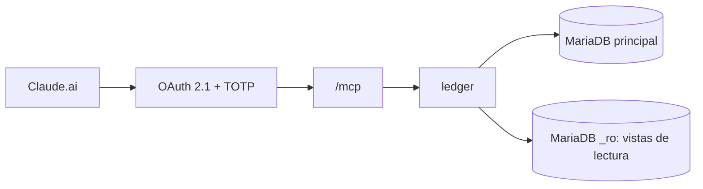

# FinanceManager

Finanzas personales con Claude como interfaz conversacional, respaldadas por un libro contable auditable.

## Qué resuelve

FinanceManager registra ingresos, gastos, transferencias, préstamos y saldos en varias monedas. Claude.ai se conecta como interfaz principal mediante MCP remoto y OAuth; la aplicación no incluye IA ni llama a una API de IA, así que no añade coste de API.

## Demostración

Conversación ficticia; los importes y personas son de ejemplo:

> **Tú:** Registra 45,50 BOB de almuerzo desde Efectivo, en Gastos › Comida.
>
> **Claude:** Registré el gasto. Efectivo queda en 454,50 BOB. Operación: `op-ejemplo-01`.
>
> **Tú:** Transfiere 696 BOB a mi cuenta en USD. Recibí 100 USD.
>
> **Claude:** Registré ambos importes y la conversión. Operación: `op-ejemplo-02`.
>
> **Tú:** Presté 1.000 BOB a Ana el 1 de enero de 2024 al 2 % mensual. ¿Cuánto debe al 31 de enero?
>
> **Claude:** El interés simple acumulado es 19,73 BOB; el saldo total es 1.019,73 BOB.
>
> **Tú:** Deshaz el gasto del almuerzo.
>
> **Claude:** Gasto revertido. La transferencia y el préstamo siguen registrados.

### Préstamos en Claude

- Usa `registrar_prestamo` para dar de alta el préstamo. Si es sin interés, indica tasa 0 y el período. Si el dinero ya se movió y quedó registrado en el historial, indica `sin_movimiento_de_caja`.
- Usa `consultar_prestamos` para ver el saldo a una fecha, el desglose y los abonos, o para listar por persona o estado con totales separados por moneda.
- Usa `abonar_prestamo` para registrar un pago. Cubre primero los intereses pendientes y luego el capital. Para corregirlo, ejecuta `deshacer_operacion` con el ID devuelto. Si hay abonos posteriores de ese préstamo, deshaz primero los más recientes.

## Incremento 1

- Libro de partida doble con cuentas, categorías, etiquetas y campos personalizados.
- Gastos, ingresos, transferencias multimoneda, carga por lotes, conciliación y valuación patrimonial.
- Préstamos hechos y recibidos con interés simple y abonos aplicados primero a intereses.
- Herramientas MCP para registrar, consultar y deshacer operaciones; consulta SQL limitada a vistas financieras de solo lectura.
- `actualizar_tipo_de_cambio_oficial` consulta el tipo oficial USD/BOB vigente a través de CUCU, un tercero sin afiliación al BCB, y lo registra si la fecha aún no tiene una cotización. Para fechas pasadas o si falla la consulta, usa `registrar_tipo_de_cambio` con la fuente y el enlace.
- Autenticación OAuth 2.1 con contraseña y TOTP.
- Copias cifradas y guías de despliegue y recuperación.

## Arquitectura



## Decisiones técnicas

- Partida doble con importes enteros en unidades menores, como centavos: [ADR 0003](docs/adr/0003-partida-doble-y-dinero.md).
- Bitácora append-only, borrado lógico y operaciones reversibles: [ADR 0006](docs/adr/0006-auditoria-y-deshacer.md).
- Consultas sobre una base separada `_ro` con vistas SQL SECURITY DEFINER y usuario lector: [ADR 0002](docs/adr/0002-mariadb.md).
- OAuth 2.1 con TOTP y Claude mediante MCP: [ADR 0004](docs/adr/0004-claude-via-mcp.md).
- Monolito modular TypeScript: [ADR 0001](docs/adr/0001-monolito-modular-typescript.md).
- Extensiones controladas por metadatos: [ADR 0005](docs/adr/0005-extensibilidad-controlada.md).
- Despliegue en cPanel con Passenger sin costes recurrentes adicionales: [ADR 0007](docs/adr/0007-despliegue-cpanel-passenger.md).

## Calidad

La última ejecución documentada en M-008B reportó **46 pruebas unitarias/HTTP, 115 de integración y tres suites Bash**; también pasaron build, lint, typecheck y formato. La integración usó MariaDB 10.6.28. Comandos: `npm test`, `npm run test:integration`, `bash src/deploy/deploy.test.sh`, `bash src/deploy/backup.test.sh` y `bash src/deploy/guide.test.sh`.

## Puesta en marcha local

Requiere Node.js 22 y MariaDB 10.6. Sigue la [guía de entorno local](docs/desarrollo/entorno-local.md) para preparar la instancia de MariaDB, configurar `.env` y proporcionar la URL de administración al ejecutar `db:setup`.

```powershell
npm ci
npm run db:start
npm run db:setup
npm run dev
```

## Comandos

- `npm run dev` inicia Express y Vite. El endpoint de salud está en `http://localhost:3000/health` y la web se abre en `http://localhost:5173`. Puedes cambiar el puerto de Express con `PORT` en `.env`.
- `npm run build` genera `dist/` en cada workspace. Ejecuta `node app.js` para servir el build de la web, `/health` y `/mcp` desde el mismo proceso.
- `npm run migrate`, después de compilar, aplica migraciones sobre `MIGRATION_DATABASE_URL` y actualiza las vistas de `READONLY_DATABASE_NAME`. Con el `.env` de ejemplo apunta a `finance_dev` y `finance_dev_ro`.
- `/mcp` exige un token de acceso OAuth con el ámbito `finance`. Configura `PUBLIC_URL` y `TOTP_ENCRYPTION_KEY`, aplica las migraciones y ejecuta `npm run auth:setup` en una terminal para crear el usuario con contraseña y TOTP. En desarrollo, puedes omitir `PUBLIC_URL` para usar `http://localhost` con `PORT`.
- Desde Claude puedes registrar gastos, importar capturas en lotes reversibles y consultar saldos, movimientos o patrimonio. `consulta_sql` usa `READONLY_DATABASE_URL` con un usuario lector y las vistas de la base de solo lectura.
- `npm run auth:tokens -- list` lista los identificadores de tokens activos. Usa `npm run auth:tokens -- revoke <id>` para revocar una familia o `npm run auth:tokens -- revoke-all` para desconectar todos los clientes.
- `npm run auth:unlock` borra los intentos vigentes de inicio de sesión y conserva los tokens emitidos.

## Pruebas

- `npm test` ejecuta las pruebas unitarias y HTTP sin MariaDB.
- `npm run test:integration` requiere el build y MariaDB local preparada con `db:setup`. **Borra y recrea** `finance_test` y `finance_test_ro` en cada ejecución. Comprueba el arranque, el esquema, los perfiles de acceso, la contabilidad, OAuth, MCP, las copias y la restauración. En Windows, usa Git para Windows y los clientes de `MARIADB_HOME/bin`. En Linux, Bash, `mysqldump` y `mysql` deben estar en `PATH`.
- `bash src/deploy/deploy.test.sh` comprueba el despliegue con dobles y un repositorio Git temporal. `bash src/deploy/backup.test.sh` y `bash src/deploy/guide.test.sh` comprueban las copias y la guía de operación. En Windows, usa WSL para las suites Bash y `FINANCE_TEST_WSL_BACKUP=1` en la integración para incluir la restauración real con GPG y flock.
- `npm run lint`, `npm run typecheck` y `npm run format:check` verifican el código y el formato.

## Estructura del repositorio

- `src/core/` contiene las validaciones y reglas contables puras, además del código compartido.
- `src/server/` contiene la app HTTP, su punto de entrada y los scripts de MariaDB local.
- `src/server/ledger/` contiene los servicios contables que escriben en MariaDB y registran la bitácora.
- `src/server/mcp/` valida entradas y adapta los servicios contables a las herramientas en español.
- `src/deploy/` contiene los scripts de despliegue y copias cifradas y sus pruebas en Bash.
- `src/web/` contiene la aplicación React y la configuración de shadcn/ui.
- `src/scripts/` contiene la comprobación de versión de Node para las pruebas.
- `docs/` contiene la documentación del proyecto.

## Despliegue

La [guía de despliegue](docs/operacion/despliegue.md) cubre cPanel, Passenger, rollback, alta de usuario y conexión de Claude con OAuth. La [guía de recuperación](docs/operacion/recuperacion.md) detalla la restauración de copias desde Drive.

## Hoja de ruta

Después del dashboard están previstos presupuestos, movimientos recurrentes y objetivos financieros.

## Dashboard v1

Abre la raíz del sitio e inicia sesión con la contraseña creada mediante `npm run auth:setup`. El dashboard usa solo contraseña por decisión de Mateo. Claude conserva el flujo OAuth con TOTP.

- **Resumen** muestra patrimonio, efectivo y cuentas de subtipo banco, ingresos y gastos frente al mes anterior, principales categorías y los últimos movimientos del mes elegido. El disponible se conserva por moneda. Las categorías se ordenan por su valor conocido en Bs al cierre. Si falta una cotización para un saldo, el patrimonio se muestra como parcial.
- **Movimientos** permite buscar y filtrar el libro. Los totales diarios incluyen todos los movimientos que coinciden con los filtros. **Informes** compara ingresos y gastos por moneda y muestra el patrimonio en Bs al cierre de cada mes. El rango admite hasta 60 meses.
- **Actividad de Claude** muestra los cambios de Claude y de la web. Deshacer agrega una operación de reversión con actor `web`. Si una operación posterior entra en conflicto, el ledger informa el motivo al intentar la reversión.

La cookie de sesión dura 12 horas desde el inicio. Es `HttpOnly`, `SameSite=Strict` y usa `Secure` con el prefijo `__Host-` bajo HTTPS. La base solo guarda el hash del token. El bloqueo por intentos se comparte con OAuth y el inicio de sesión queda en la bitácora de autenticación. La API exige la sesión, usa `Cache-Control: no-store` y comprueba el origen configurado para toda solicitud distinta de GET o HEAD. Cerrar sesión revoca la sesión actual. Para revocar todas las sesiones web y credenciales OAuth activas, ejecuta `npm run auth:tokens -- revoke-all`.

Para probar con Vite, configura `PUBLIC_URL=http://localhost:5173` en tu entorno local y abre esa misma dirección. Vite reenvía `/api` al puerto de Express. Con Express sirviendo el build, usa el origen de Express.

## Licencia

Pendiente.

## English summary

FinanceManager is a personal finance ledger controlled through Claude.ai over remote MCP and OAuth. It supports double-entry, multiple currencies, reversible operations, simple-interest loans, and encrypted backups. The web dashboard supports read-only views and operation reversal.
