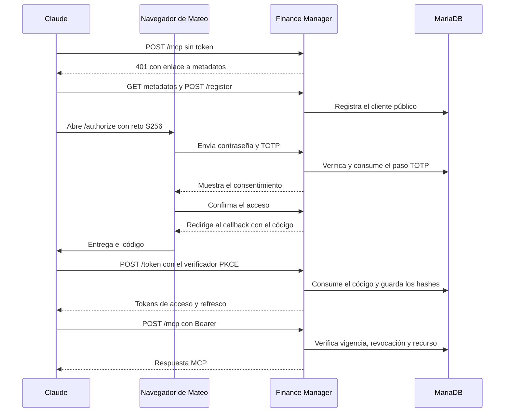

# Arquitectura

## Visión general

## Componentes y responsabilidades

- `src/core` contiene los esquemas Zod de las entradas y las reglas puras de dinero, fecha, cuadre y conversión.
- `src/server/ledger` ofrece la API de servicios TypeScript mediante `createLedger(db, actor)`. Usa Kysely para aplicar esas reglas a las cuentas, asientos, catálogos y consultas.

## Stack tecnológico

- Node.js 22 y TypeScript estricto con npm workspaces.
- `core` proporciona el código compartido. `server` expone la API HTTP con Express. `web` usa React, Vite, Tailwind CSS y shadcn/ui.
- MariaDB 10.6 almacena los datos en tablas InnoDB con `utf8mb4`. El servidor usa Kysely sobre un pool de `mysql2`.
- Cada pool abre hasta 5 conexiones y admite hasta 64 solicitudes en espera. Cada conexión inicia con `STRICT_ALL_TABLES,NO_ENGINE_SUBSTITUTION,ERROR_FOR_DIVISION_BY_ZERO` y zona horaria UTC. `/health` comparte y conserva el resultado de su comprobación durante 10 segundos. Su plazo total es de 1,5 segundos, incluso cuando espera una conexión.
- Vitest ejecuta las pruebas, Supertest comprueba la API HTTP y Testing Library comprueba la interfaz. ESLint, TypeScript y Prettier verifican el código.

## Autenticación MCP

Express usa `mcpAuthRouter` y `requireBearerAuth` del SDK de MCP. Publica metadatos OAuth del emisor y del recurso a partir de `PUBLIC_URL`. Solo admite el ámbito `finance`, clientes públicos y códigos con PKCE S256. `/health` es público.

Los códigos duran cinco minutos y los tokens de acceso duran una hora, hasta el límite de vida de su familia. Cada refresco rota el token, con una ventana deslizante de 30 días y un máximo de 90 días desde la emisión inicial. Si se vuelve a presentar un código consumido con el verificador PKCE correcto, se revoca la familia. El SDK rechaza antes las peticiones sin verificador válido. Reutilizar un refresco rotado también revoca su familia. MariaDB guarda hashes SHA-256 de tokens opacos de 32 bytes. La contraseña se deriva con scrypt y una sal individual. El secreto TOTP se cifra con AES-256-GCM y una clave de entorno.

La emisión y el refresco purgan los códigos vencidos hace más de un día, los intentos de más de 24 horas y los clientes de más de 30 días sin tokens vigentes. Se conserva el registro hash de un código consumido mientras su familia tenga tokens vigentes para poder detectar el reuso. Los eventos de autenticación se conservan.

El formulario usa un token CSRF y una cookie ligados a la solicitud. MariaDB serializa los cambios de autenticación y cuenta los intentos fallidos por IP y globalmente. Los eventos registran el tipo, resultado, IP, agente truncado, cliente y fecha UTC. Los datos de autenticación quedan en la base principal, fuera de las vistas de consulta. El endpoint OAuth `/revoke` limita al cliente a la familia del token que presenta. Los comandos administrativos se ejecutan en la terminal del servidor.

## Datos contables

`accounts` guarda el árbol de cuentas y categorías. Las categorías son cuentas de ingreso y gasto. Una cuenta de activo o pasivo tiene moneda fija, mientras que las de ingreso, gasto y patrimonio admiten líneas en varias monedas. Los activos pueden ser `banco`, `efectivo`, `ahorro`, `inversion` o `por_cobrar`. Los pasivos pueden ser `tarjeta_credito` o `prestamo_recibido`. `currencies` define las unidades mínimas. Solo se exige un nombre único entre hermanos activos, incluidas las raíces.

`transactions` guarda el asiento y su fecha contable sin hora. La fecha contable por defecto es la de America/La_Paz. Las marcas de tiempo usan `DATETIME(3)`. Sus valores por defecto se calculan en la zona de la sesión, que la app y el migrador fijan en UTC. Antes de escribir desde phpMyAdmin o la consola, ejecuta `SET SESSION time_zone = '+00:00';` en esa conexión.

`postings` registra las líneas en unidades mínimas. Débito es positivo y crédito es negativo. El saldo natural de activo y gasto es la suma de las líneas. El saldo natural de pasivo, ingreso y patrimonio invierte el signo. Cada asiento requiere al menos dos líneas, todas con importe distinto de cero y con suma cero por moneda. Una cuenta de activo o pasivo solo admite líneas en su moneda. Las transferencias multimoneda guardan los dos importes reales y dos contrapartidas en Cambio de moneda. El borrado lógico excluye el asiento de los saldos.

La API recibe importes de línea positivos en cadena decimal o boliviana. Se recortan los espacios de los extremos y se rechaza un único separador seguido de tres dígitos por ambiguo. La coma identifica la fracción del formato boliviano cuando se usan puntos de millares. Se rechazan los importes con más decimales que los de la moneda. Saldos, acumulados y conversiones se calculan con `bigint`. La conciliación compara el saldo natural al cierre de la fecha contable con el saldo real indicado y registra la diferencia. Antes de confirmar cada escritura, incluido deshacer, se comprueba que las cuentas archivadas de activo y pasivo tengan saldo cero considerando todos los asientos vigentes, incluidos los fechados en el futuro. Para editar o borrar un asiento con líneas en una de esas cuentas, primero hay que revertir su archivado.

`exchange_rates` guarda tipos entre monedas distintas por fecha, par y fuente. Una unidad de `from_currency` equivale a `rate` unidades de `to_currency`. La valuación usa el último tipo del par directo hasta la fecha solicitada. Ante varias fuentes el mismo día, primero se elige el nombre exacto `BCB referencial venta` y luego la primera fuente en el orden de `utf8mb4_unicode_ci`. Se usa aritmética entera a escala 10¹⁰ y se redondea a la unidad mínima de destino, mitad lejos de cero. El patrimonio convierte y redondea a BOB por cuenta antes de sumar, así el total coincide con la suma de las líneas del reporte. Informa las cuentas cuyo saldo no pudo valuar. La conversión se realiza en la consulta y no genera asientos.

`transaction_tags` relaciona asientos y etiquetas. Los nombres se comparan con la colación de la tabla para compartir etiquetas como `Viaje` y `viaje`. `custom_field_definitions` define los campos almacenados como JSON en cuentas y asientos. Las altas y los cambios de `custom` validan todas las claves contra las definiciones activas. El lote de importación compara asientos vigentes de la misma fecha por las líneas `(cuenta, moneda, importe)`, sin importar su orden y conservando repeticiones.

## Operaciones y deshacer

Cada escritura del servicio usa una transacción que bloquea la raíz Ingresos para serializar las decisiones que abarcan varias filas. El módulo de escritura crea una sola fila en `operations` y una en `audit_log` por cada fila de dominio modificada. Las llamadas sin cambios, como conciliar un saldo igual, no crean una operación. La lista de operaciones se ordena por `seq` descendente. El correlativo puede tener saltos.

La bitácora conserva cada fila completa antes y después del cambio, salvo `active_parent_id`, que MariaDB calcula. `BIGINT`, `DECIMAL(24,10)` y las columnas JSON llegan como cadenas desde el driver. Guardar el texto original de las columnas JSON preserva la representación exacta al restaurarlas. Los triggers impiden modificar o borrar entradas de la bitácora. La cuenta de migración conserva los permisos DDL necesarios para restaurar el esquema.

Deshacer bloquea la operación objetivo, verifica el estado actual de las filas contra las columnas del `after` registrado y aplica el inverso en orden descendente de bitácora. La comparación ignora `updated_at`. Si se restaura una actualización, las columnas ausentes de la foto conservan su valor actual. Una columna incorporada después de la operación usa su valor por defecto si se reinserta la fila. La reinserción de una fila que ya existe con los mismos valores se omite solo si ninguna operación posterior vigente cambió esa fila. Si otros asientos conservan una referencia a una etiqueta que se iba a borrar, `undoOperation` la conserva y devuelve su ID y nombre en `retainedTags`. Los cambios posteriores vigentes y los demás conflictos de integridad bloquean la reversión. Cuando la bitácora identifica la operación posterior que causó el conflicto, el mensaje incluye su ID. Cada operación admite un único deshacer directo. Deshacer esa reversión rehace el cambio. La lista informa el estado efectivo de una operación según la paridad de su cadena de reversiones.

## Consultas y migraciones

La base de consulta contiene vistas `SQL SECURITY DEFINER` con columnas explícitas y `ALGORITHM=TEMPTABLE`, que impide actualizarlas. Así quedan fuera la bitácora y los objetos que se agreguen a la base principal. `v_accounts` incluye las cuentas archivadas con `archived_at`. `v_transactions`, `v_postings` y `v_transaction_tags` excluyen asientos borrados lógicamente. `v_postings` conserva el nombre y tipo de la cuenta e incluye la fecha contable del asiento. `v_custom_field_definitions` muestra solo las definiciones activas. Los valores JSON `custom` se reservan para la aplicación, lo que evita devolver valores de campos archivados.

Las migraciones TypeScript viven en `src/server/migrations`. Se aplican hacia adelante en orden `AAAAMMDDHHMM_descripcion`. `npm run migrate` comprueba los permisos de triggers antes de inicializar Kysely. Después de aplicar las migraciones, recrea las vistas con el usuario de migración y elimina las vistas obsoletas cuyo nombre empieza por `v_`. El DDL de MariaDB puede dejar cambios parciales si falla una migración. El despliegue toma un volcado previo para recuperar la base principal.
