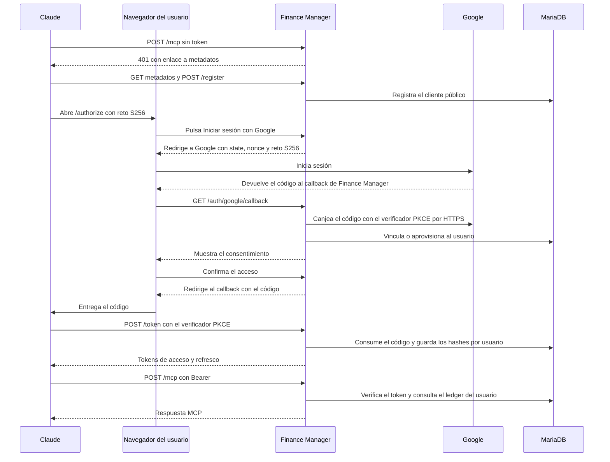

# Arquitectura

## Visión general

## Componentes y responsabilidades

- `src/core` contiene los esquemas Zod de las entradas y las reglas puras de dinero, fecha, cuadre y conversión.
- `src/server/ledger` ofrece la API de servicios TypeScript mediante `createLedger(db, actor, userId)`. Usa Kysely para aplicar esas reglas a las cuentas, asientos, catálogos y consultas.
- `src/server/mcp` publica herramientas en español tras OAuth. Valida los argumentos con Zod, delega en el dominio con el actor `claude` y devuelve datos estructurados y un resumen breve. Cada operación registrada incluye el ID para deshacerla.

## Stack tecnológico

- Node.js 22 y TypeScript estricto con npm workspaces.
- `core` proporciona el código compartido. `server` expone la API HTTP con Express. `web` usa React, Vite, Tailwind CSS y shadcn/ui.
- MariaDB 10.6 almacena los datos en tablas InnoDB con `utf8mb4`. El servidor usa Kysely sobre un pool de `mysql2`.
- El pool principal abre hasta 5 conexiones. El pool admite hasta 64 solicitudes en espera. Cada conexión inicia con `STRICT_ALL_TABLES,NO_ENGINE_SUBSTITUTION,ERROR_FOR_DIVISION_BY_ZERO` y zona horaria UTC. `/health` comparte y conserva el resultado de su comprobación durante 10 segundos. Su plazo total es de 1,5 segundos, incluso cuando espera una conexión.
- Vitest ejecuta las pruebas, Supertest comprueba la API HTTP y Testing Library comprueba la interfaz. ESLint, TypeScript y Prettier verifican el código.

## Autenticación MCP

Express usa `mcpAuthRouter` y `requireBearerAuth` del SDK de MCP. Publica metadatos OAuth del emisor y del recurso a partir de `PUBLIC_URL`. Solo admite el ámbito `finance`, clientes públicos y códigos con PKCE S256. `/health` es público.

Los códigos duran cinco minutos y los tokens de acceso duran una hora, hasta el límite de vida de su familia. Cada refresco rota el token, con una ventana deslizante de 30 días y un máximo de 90 días desde la emisión inicial. Si se vuelve a presentar un código consumido con el verificador PKCE correcto, se revoca la familia. El SDK rechaza antes las peticiones sin verificador válido. Reutilizar un refresco rotado también revoca su familia. MariaDB guarda hashes SHA-256 de tokens opacos de 32 bytes. Los códigos y tokens de Claude pertenecen al usuario que autorizó la conexión.

La emisión y el refresco purgan los códigos vencidos hace más de un día y los clientes de más de 30 días sin tokens vigentes. Se conserva el registro hash de un código consumido mientras su familia tenga tokens vigentes para poder detectar el reuso. Los eventos de autenticación se purgan al año.

Los formularios usan un token CSRF y una cookie ligados a la solicitud. El callback de Google consume el `state` ligado al navegador y valida el ID token recibido por HTTPS. MariaDB serializa el registro y los cambios de credenciales OAuth entre procesos. Los eventos registran el tipo, resultado, IP, agente truncado, cliente y fecha UTC. Los datos de autenticación quedan en la base principal, fuera de las vistas de consulta. El endpoint OAuth `/revoke` limita al cliente a la familia del token que presenta. El dashboard identifica al usuario mediante la sesión web y aplica CSRF por origen. Los límites de login usan la IP del cliente. Los contadores de `/api` y `/mcp` se comparten en MariaDB por usuario y minuto UTC.

## Datos contables

`users` identifica al dueño de los datos contables. La migración asigna las filas existentes al usuario #1 y conserva los IDs, las marcas de tiempo y las instantáneas de auditoría. El usuario #1 se crea sin identidad de Google vinculada y se vincula al primer inicio de sesión válido con `FIRST_USER_EMAIL`. Al provisionar a un usuario nuevo se crean sus raíces del sistema, las subcuentas de intereses y ocho categorías básicas. El ledger aplica el alcance de usuario a las lecturas y escrituras. Las claves foráneas compuestas impiden vincular filas de distintos usuarios en cuentas, asientos, etiquetas, préstamos y bitácora.

`MAX_ACCOUNTS_PER_USER`, `MAX_TAGS_PER_USER`, `MAX_GOALS_PER_USER` y `MAX_TRANSACTIONS_PER_USER_PER_DAY` fijan los topes. Los valores predeterminados son 500 cuentas y categorías, 500 etiquetas, 100 metas (incluidas las archivadas) y 2.000 movimientos nuevos por día. El último tope cuenta altas según el día de America/La_Paz, con independencia de la fecha contable.

`accounts` guarda el árbol de cuentas y categorías. Las categorías son cuentas de ingreso y gasto. Una cuenta de activo o pasivo tiene moneda fija, mientras que las de ingreso, gasto y patrimonio admiten líneas en varias monedas. Los activos pueden ser `banco`, `efectivo`, `ahorro`, `inversion` o `por_cobrar`. Los pasivos pueden ser `tarjeta_credito` o `prestamo_recibido`. `currencies` define las unidades mínimas. Solo se exige un nombre único entre hermanos activos, incluidas las raíces.

`transactions` guarda el asiento y su fecha contable sin hora. La fecha contable por defecto es la de America/La_Paz. Las marcas de tiempo usan `DATETIME(3)`. Sus valores por defecto se calculan en la zona de la sesión, que la app y el migrador fijan en UTC. Antes de escribir desde phpMyAdmin o la consola, ejecuta `SET SESSION time_zone = '+00:00';` en esa conexión.

`postings` registra las líneas en unidades mínimas. Débito es positivo y crédito es negativo. El saldo natural de activo y gasto es la suma de las líneas. El saldo natural de pasivo, ingreso y patrimonio invierte el signo. Cada asiento requiere al menos dos líneas, todas con importe distinto de cero y con suma cero por moneda. Una cuenta de activo o pasivo solo admite líneas en su moneda. Las transferencias multimoneda guardan los dos importes reales y dos contrapartidas en Cambio de moneda. El borrado lógico excluye el asiento de los saldos.

La API recibe importes de línea positivos en cadena decimal o boliviana. Se recortan los espacios de los extremos y se rechaza un único separador seguido de tres dígitos por ambiguo. La coma identifica la fracción del formato boliviano cuando se usan puntos de millares. Se rechazan los importes con más decimales que los de la moneda. Saldos, acumulados y conversiones se calculan con `bigint`. La conciliación compara el saldo natural al cierre de la fecha contable con el saldo real indicado y registra la diferencia. Antes de confirmar cada escritura, incluido deshacer, se comprueba que las cuentas archivadas de activo y pasivo tengan saldo cero considerando todos los asientos vigentes, incluidos los fechados en el futuro. Para editar o borrar un asiento con líneas en una de esas cuentas, primero hay que revertir su archivado.

`exchange_rates` guarda tipos entre monedas distintas por fecha, par y fuente. Una unidad de `from_currency` equivale a `rate` unidades de `to_currency`. La valuación usa el tipo más reciente del par directo hasta la fecha solicitada entre los tipos del usuario y los oficiales compartidos. En la misma fecha tiene prioridad el tipo del usuario. Ante varias fuentes propias el mismo día, primero se elige el nombre exacto `BCB referencial venta` y luego la primera fuente en el orden de `utf8mb4_unicode_ci`. Se usa aritmética entera a escala 10¹⁰ y se redondea a la unidad mínima de destino, mitad lejos de cero. El patrimonio convierte y redondea a BOB por cuenta antes de sumar, así el total coincide con la suma de las líneas del reporte. Informa las cuentas cuyo saldo no pudo valuar. La conversión se realiza en la consulta y no genera asientos.

El oficial tiene `user_id NULL` y es único por par y fecha. La migración comparte las cotizaciones históricas cuya fuente empieza por `Tipo de cambio oficial BCB vía apibcb.cucu.bo`. Para cada par y fecha conserva el oficial que ya esté compartido si existe. Entre las cotizaciones históricas coincidentes conserva la de menor `id` asignado por la migración. Las demás se eliminan de `exchange_rates` y sus entradas de bitácora se conservan.

`transaction_tags` relaciona asientos y etiquetas. Los nombres se comparan con la colación de la tabla para compartir etiquetas como `Viaje` y `viaje`. `custom_field_definitions` define los campos almacenados como JSON en cuentas y asientos. Las altas y los cambios de `custom` validan todas las claves contra las definiciones activas. El lote de importación compara asientos vigentes de la misma fecha por las líneas `(cuenta, moneda, importe)`, sin importar su orden y conservando repeticiones.

## Préstamos e interés simple

`loans` relaciona cada préstamo con una cuenta raíz exclusiva y de moneda fija. Su capital inicial y capital pagado se guardan en unidades mínimas. Para un préstamo hecho, el alta debita `por_cobrar` y acredita caja. Para uno recibido, debita caja y acredita `prestamo_recibido`. Si la caja ya quedó registrada en el historial, el alta usa `Saldos iniciales` como contrapartida. Los abonos mueven caja, reducen el capital por la parte que corresponde y contabilizan el interés cobrado en Ingresos › Intereses o pagado en Gastos › Intereses. La migración prepara esas dos categorías de sistema y los abonos las localizan por su marca `loan_interest`. Bajo cada raíz, la migración conserva el ID de la categoría Intereses activa si existe, reactiva la archivada con mayor ID si solo hay archivadas o crea una categoría si falta. Ambas admiten ingresos o gastos manuales, según corresponda.

El interés de cada tramo es capital pendiente × tasa diaria × días naturales transcurridos. Para una tasa anual, la tasa diaria es porcentaje ÷ 100 ÷ 365. Para una tasa mensual es porcentaje ÷ 100 × 12 ÷ 365. La base es de 365 días incluso en años bisiestos. Un capital de 1.000,00 BOB al 24 % anual durante 366 días devenga 240,66 BOB redondeados. A una tasa mensual del 2 % durante 30 días, ese mismo capital devenga 19,726027… BOB, redondeados a 19,73 BOB. Un abono de 100,00 BOB cubre ese interés y deja 919,73 BOB de capital, la base del siguiente tramo.

La tasa se almacena como `DECIMAL(9,6)` en porcentaje. El núcleo usa `bigint` con denominador común 36.500.000.000 para calcular fracciones de la unidad mínima. Al abonar o consultar, redondea el interés pendiente a la unidad mínima, con los empates alejándose de cero. El abono resta solo el interés efectivamente pagado del numerador exacto. Así conserva en `interest_carry` tanto el interés impago como las fracciones, incluido un resto negativo cuando se redondeó hacia arriba. En el ejemplo queda un resto de −0,003972… BOB que se compensa con el devengo posterior. El interés exigible tiene un mínimo de cero. El resto nunca forma parte del capital.

Cada abono actualiza la fecha del último pago, los importes pagados, el resto y la marca de cierre dentro de la misma operación auditada que el asiento. Para reconstruir el saldo y el desglose a una fecha, el servicio consulta las fotos de esos estados asociadas con asientos vigentes hasta ese día. Deshacer el último abono restaura el estado anterior y retira el asiento. Para corregir un asiento del préstamo, se usa su operación de deshacer. Las escrituras contables generales rechazan nuevas líneas en la cuenta del préstamo. La vista `v_loans` expone los datos del préstamo y los acumulados registrados. Para obtener el interés devengado a una fecha, usa `consultar_prestamos`.

## Metas financieras

`goals` conserva el nombre único por usuario, el monto objetivo en unidades mínimas, la moneda, las fechas y el estado de archivado. `goal_accounts` vincula una meta de ahorro con una o más cuentas de activo o pasivo. Un tope se vincula a una categoría de gastos. Las claves compuestas restringen las relaciones al dueño de la meta. Crear, modificar y archivar se auditan y se pueden deshacer. Ambas tablas se incluyen en la exportación y el borrado de cuenta.

El ahorro suma los saldos naturales de las cuentas elegidas al día de consulta. Si hay vencimiento futuro, el ritmo mensual es el importe pendiente prorrateado a 30 días y redondeado hacia arriba a la unidad mínima. Al cumplirse el plazo, si falta saldo, se devuelve cero días y el ritmo mensual queda sin valor. El tope suma los gastos vigentes de la categoría y sus descendientes en un rango inclusivo. Sin fechas explícitas, el período empieza el primer día del mes en America/La_Paz y termina el último. Las conversiones usan la regla de valuación del patrimonio para la moneda de la meta, al día de consulta o al cierre del período si ya terminó. Si falta una cotización para un importe distinto de cero, `ver_metas` informa las monedas pendientes de valuar y deja el avance sin valor.

`v_goals` y `v_goal_accounts` usan el mismo alcance de sesión que las demás vistas de consulta. La exportación usa cadenas decimales para los montos de dominio y sus instantáneas de auditoría. En los préstamos, `interest_carry` conserva el numerador exacto escalado a la unidad mayor de la moneda. Se divide ese decimal entre 36.500.000.000 para obtener el interés pendiente sin redondear.

## Operaciones y deshacer

Cada escritura del servicio usa una transacción que bloquea la raíz Ingresos del usuario para serializar sus decisiones. El módulo de escritura crea para ese usuario una sola fila en `operations` y una en `audit_log` por cada fila de dominio modificada. Las llamadas sin cambios, como conciliar un saldo igual, no crean una operación. La lista de operaciones se ordena por `seq` descendente. El correlativo puede tener saltos.

La bitácora conserva las filas antes y después del cambio. Omite columnas generadas y toma el dueño de la operación. Las cotizaciones nuevas registran también su dueño en la instantánea. Las operaciones de tipos oficiales compartidos, incluidas las de cotizaciones migradas de CUCU, son irreversibles desde el ledger. `BIGINT`, `DECIMAL(24,10)` y las columnas JSON llegan como cadenas desde el driver. Guardar el texto original de las columnas JSON preserva la representación exacta al restaurarlas. Los triggers impiden modificar o borrar entradas de la bitácora. La cuenta de migración conserva los permisos DDL necesarios para restaurar el esquema.

Deshacer bloquea la operación objetivo, verifica el estado actual de las filas contra las columnas del `after` registrado y aplica el inverso en orden descendente de bitácora. La comparación ignora `updated_at`. Si se restaura una actualización, las columnas ausentes de la foto conservan su valor actual. Una columna incorporada después de la operación usa su valor por defecto si se reinserta la fila. La reinserción de una fila que ya existe con los mismos valores se omite solo si ninguna operación posterior vigente cambió esa fila. Si otros asientos conservan una referencia a una etiqueta que se iba a borrar, `undoOperation` la conserva y devuelve su ID y nombre en `retainedTags`. Los cambios posteriores vigentes y los demás conflictos de integridad bloquean la reversión. Cuando la bitácora identifica la operación posterior que causó el conflicto, el mensaje incluye su ID. Cada operación admite un único deshacer directo. Deshacer esa reversión rehace el cambio. La lista informa el estado efectivo de una operación según la paridad de su cadena de reversiones.

## Consultas y migraciones

La base de consulta contiene vistas `SQL SECURITY DEFINER` con columnas explícitas y `ALGORITHM=TEMPTABLE`, que impide actualizarlas. Así quedan fuera la bitácora y los objetos que se agreguen a la base principal. `v_accounts` incluye las cuentas archivadas con `archived_at`. `v_transactions`, `v_postings` y `v_transaction_tags` excluyen asientos borrados lógicamente. `v_postings` conserva el nombre y tipo de la cuenta e incluye la fecha contable del asiento. `v_custom_field_definitions` muestra solo las definiciones activas. Los valores JSON `custom` se reservan para la aplicación, lo que evita devolver valores de campos archivados.

`consulta_sql` acepta una sentencia `SELECT` o `WITH` no recursiva. El validador limita las fuentes a las vistas financieras sin calificar y los CTE de la consulta. Rechaza las referencias a esquemas reservados, variables, `INTO`, comentarios ejecutables y comentarios de línea (`--`, `#`). Fuera de cadenas e identificadores entre backticks solo admite ASCII imprimible y separadores ASCII de SQL. MariaDB concede lectura implícita de `information_schema` al usuario lector. El validador bloquea ese acceso desde MCP.

El servidor reserva una conexión del pool lector y asocia su ID al usuario autenticado en una tabla de la base principal. Las vistas requieren un mapeo vigente y un bloqueo de MariaDB asociado a esa conexión. El bloqueo se pierde al cerrarla o al reiniciar el motor, y el mapeo vence a los 10 segundos. El servidor borra el mapeo al terminar y elimina los huérfanos o vencidos al arrancar y antes de cada consulta. Las opciones del optimizador de cada sentencia mantienen las condiciones externas fuera de las vistas materializadas. Si falta el mapeo, las vistas devuelven cero filas. Con un mapeo válido, el usuario solo ve sus datos y las cotizaciones oficiales compartidas.

La cuenta lectora tiene SELECT en la base de vistas. MariaDB ejecuta la consulta en una transacción de solo lectura y aplica un límite de 5 segundos por sentencia. La herramienta devuelve hasta 500 filas y 64 KB. Si recorta, avisa al cliente y destruye el socket de la conexión retirada del pool. El catálogo de columnas de la herramienta se genera a partir de las definiciones de las vistas.

`listar_cuentas` conserva la ruta completa de cada cuenta y marca los IDs de ancestros archivados en `ancestros_archivados`. Para archivar una cuenta con hijas activas hay que archivarlas o moverlas primero. Los importes de las herramientas MCP usan la unidad mínima registrada de su moneda.

En `resumen_periodo`, los totales incluyen las categorías archivadas dentro de la rama consultada. Sin una rama, abarcan todas las categorías. El desglose muestra filas archivadas solo con `incluir_archivadas` y el importe de cada fila suma el de sus descendientes.

Las migraciones TypeScript viven en `src/server/migrations`. Se aplican hacia adelante en orden `AAAAMMDDHHMM_descripcion`. `npm run migrate` comprueba los permisos de triggers antes de inicializar Kysely. Después de aplicar las migraciones, recrea las vistas con el usuario de migración y elimina las vistas obsoletas cuyo nombre empieza por `v_`. El DDL de MariaDB puede dejar cambios parciales si falla una migración. El despliegue toma un volcado previo para recuperar la base principal.

La migración de propiedad admite reintentos de su DDL. `migrate` habilita el mapeo de `consulta_sql` cuando termina de crear todas las vistas filtradas. El plan P-002 requiere la aprobación de este cambio antes del despliegue.
